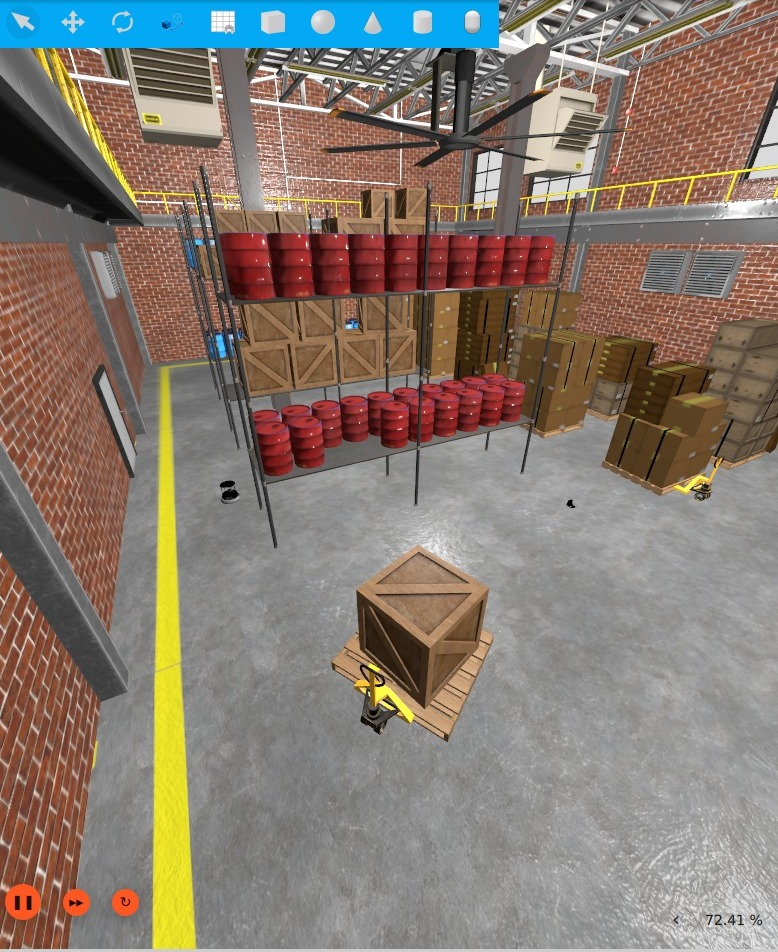
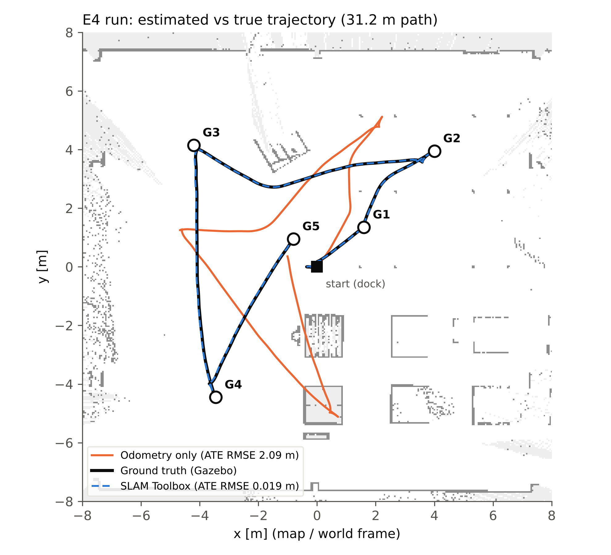

# SLAM Toolbox + Nav2 on a simulated TurtleBot 4

ICTE4001 Introduction to Autonomous Robots — Case Study 2 (Curtin University), Group [##].

This repository contains everything needed to reproduce the application and evaluation part of our report
*Graph-Based SLAM with SLAM Toolbox: Theory, Implementation Analysis and Evaluation on TurtleBot4*:
the environment set-up, launch sequence, SLAM Toolbox configuration files, experiment scripts,
evaluation scripts, numerical results, figures, and troubleshooting notes.

| | |
|---|---|
| Robot | Virtual TurtleBot 4 (standard) in Gazebo Sim 8 (Harmonic), `depot` world |
| SLAM | SLAM Toolbox 2.8.5, synchronous mapping, Ceres solver |
| Navigation | Nav2 (`turtlebot4_navigation`), localisation from SLAM Toolbox (no AMCL) |
| ROS 2 | Jazzy, Ubuntu 24.04 under WSL2 |



---

## 1. Environment

| Component | Version / setting |
|---|---|
| Host | MSI Windows laptop, Intel Core i5-11400H (6 cores, 2.7 GHz), NVIDIA RTX 3060 Laptop GPU, [RAM] |
| Linux | Ubuntu 24.04 under WSL2 |
| ROS 2 | Jazzy |
| Simulator | Gazebo Sim 8 (Harmonic) + TurtleBot 4 simulator packages |
| SLAM | `slam_toolbox` 2.8.5 (binary package) |
| Navigation | Nav2 via `turtlebot4_navigation` |

### Installation (Ubuntu 24.04 with ROS 2 Jazzy installed)

```bash
sudo apt update
sudo apt install ros-jazzy-turtlebot4-simulator ros-jazzy-turtlebot4-navigation ros-jazzy-slam-toolbox
```

### Environment settings (`~/.bashrc`) — needed for reliable discovery under WSL2

```bash
unset ROS_LOCALHOST_ONLY
export ROS_AUTOMATIC_DISCOVERY_RANGE=SUBNET
```

### Simulator modifications (WSL2 only)

Under WSL2 the default sensor renderer returned empty lidar scans and the real-time factor was ≈ 5 %.
Two one-off edits to the installed robot description fixed both (back up each file first):

1. Sensor render engine `ogre` → `ogre2` in `create3.urdf.xacro` (line 301).
2. Sensor update rates reduced: RPLIDAR 62 → 10 Hz; 7 IR-intensity + 4 cliff sensors 62 → 5 Hz; OAK-D camera 30 → 1 Hz.
   None of the reduced sensors is used by SLAM Toolbox or Nav2.

Result: real-time factor ≈ 1.0. Files edited (each backed up as `<file>.bak` before editing):

| File | Change |
|---|---|
| `/opt/ros/jazzy/share/irobot_create_description/urdf/create3.urdf.xacro` | sensor `render_engine` `ogre` → `ogre2` (line 301) |
| `/opt/ros/jazzy/share/turtlebot4_description/urdf/sensors/rplidar.urdf.xacro` | lidar `update_rate` 62 → 10 |
| `/opt/ros/jazzy/share/irobot_create_description/urdf/sensors/ir_intensity.urdf.xacro` | IR-intensity `update_rate` 62 → 5 |
| `/opt/ros/jazzy/share/irobot_create_description/urdf/sensors/cliff_sensor.urdf.xacro` | cliff `update_rate` 62 → 5 |
| `/opt/ros/jazzy/share/turtlebot4_description/urdf/sensors/oakd.urdf.xacro` | camera `update_rate` 30 → 1 |

To undo, copy each `.bak` file back over the edited file.

---

## 2. Launch

No workspace build is required (binary packages). Use one terminal per step, in this order:

```bash
# 1. Simulator
ros2 launch turtlebot4_gz_bringup turtlebot4_gz.launch.py world:=depot

# 2. SLAM Toolbox — start BEFORE the robot undocks (otherwise the map is rotated)
ros2 launch turtlebot4_navigation slam.launch.py use_sim_time:=true
#    experiment variants:  params:=$PWD/config/slam_noloop.yaml   (or slam_res010.yaml)

# 3. Nav2 — wait for "Managed nodes are active"
ros2 launch turtlebot4_navigation nav2.launch.py use_sim_time:=true

# 4. RViz
ros2 launch turtlebot4_viz view_navigation.launch.py use_sim_time:=true

# 5. Record data for evaluation
ros2 bag record -o ~/bags/<run_name> /tf /tf_static /odom /scan /clock /sim_ground_truth_pose

# 6. Undock, then run an experiment route
ros2 action send_goal /undock irobot_create_msgs/action/Undock "{}"
bash scripts/e4_goal.sh G1 1.60 1.35 0.70    # E4 (one goal: x y yaw, map frame)
bash scripts/e2_route.sh <run_name>          # E2 waypoint loop W1–W5, 2 laps
bash scripts/e3_route.sh <run_name>          # E3 waypoint loop W1–W2–W3–W5, 2 laps
```

E4 goal set: `G1 1.60 1.35 0.70` · `G2 4.00 3.95 0.83` · `G3 -4.20 4.15 3.12` · `G4 -3.45 -4.45 -1.48` · `G5 -0.80 0.95 1.11`

### Save the map and pose graph (while SLAM is still running, before closing any terminal)

```bash
ros2 run nav2_map_server map_saver_cli -f ~/slam_maps/<run_name> --ros-args -p save_map_timeout:=30.0
ros2 service call /slam_toolbox/serialize_map slam_toolbox/srv/SerializePoseGraph \
  "{filename: '$HOME/slam_maps/<run_name>_posegraph'}"
```

### Offline evaluation (stop the simulator first)

```bash
python3 scripts/ate_eval.py ~/bags/<run_name>     # ATE, raw and SE(2)-aligned
python3 scripts/bag_export.py ~/bags/<run_name>   # scans + SLAM/odometry/ground-truth laser poses
```

All scripts write to a folder set near the top of each file (`OUT_DIR` in the Python scripts, `DIR` in the shell scripts),
which points to the authors' Windows folder — change it to a folder on your machine.

---

## 3. Repository contents

| Path | Purpose | Change from default |
|---|---|---|
| `config/slam_default.yaml` | Baseline SLAM Toolbox parameters (E1, E2a, E3a, E4) | none (TurtleBot 4 default) |
| `config/slam_noloop.yaml` | E2b | `do_loop_closing: false` |
| `config/slam_res010.yaml` | E3b | `resolution: 0.10` |
| `config/slam_range4_loop.yaml`, `slam_range4_noloop.yaml` | Proposed follow-up (not run) | `max_laser_range: 4.0`, loop closure on/off |
| `scripts/e4_goal.sh` | Sends one `NavigateToPose` goal; logs status, time, recoveries, SLAM and ground-truth pose | |
| `scripts/e2_route.sh`, `scripts/e3_route.sh` | Scripted Nav2 waypoint loops for E2 / E3 | |
| `scripts/cpu_log.sh` | Samples SLAM Toolbox CPU and memory at 1 Hz | |
| `scripts/ate_eval.py` | Absolute trajectory error from a rosbag | |
| `scripts/bag_export.py` | Exports scans and poses for offline map rebuilding | |
| `results/` | Summary CSVs, ATE summary, saved map metadata | |
| `results/maps/` | Saved maps at 0.05 m and 0.10 m (`.pgm` + `.yaml`) | |
| `figures/` | All figures used in the report, plus the E2 route, E4 goal set and SLAM node graph | |
| `docs/` | `ros2 node info /slam_toolbox` and `slam.launch.py` arguments | |

Nav2 parameters are the unmodified TurtleBot 4 defaults (goal tolerance 0.25 m / 0.25 rad, inflation radius 0.45 m).

---

## 4. Experiments and results

| ID | What changes | ATE RMSE | Key result |
|---|---|---|---|
| E1 | Baseline (default parameters) | 0.016–0.019 m | Map precision 0.79 / recall 0.96 vs ground-truth-pose reference |
| E2 | Loop closure on vs off | 0.016 vs 0.017 m | No measurable difference in this world |
| E3 | Resolution 0.05 vs 0.10 m | 0.019 vs 0.028 m | 0.10 m: −23 % CPU, 4× smaller map, +47 % error, lost detail |
| E4 | SLAM + Nav2, 5 goals while mapping | 0.019 m (odometry only: 2.09 m) | 5/5 goals, mean final error 0.183 m, localisation error 0.013 m |



Full results, metric definitions and discussion are in Sec. 4 of the report.

**Demo video:** [screen recording of SLAM Toolbox and Nav2 driving the robot in RViz (YouTube)](https://youtu.be/3-qAF6DUQbU).

---

## 5. Troubleshooting

| Symptom | Likely cause | Fix |
|---|---|---|
| Topics intermittently missing; `/clock` has no publisher | `ROS_LOCALHOST_ONLY=1` breaks discovery under WSL2 | Unset it; `export ROS_AUTOMATIC_DISCOVERY_RANGE=SUBNET` |
| Every lidar range = 0.164 m (range_min) | `ogre` sensor renderer returns empty depth under WSL2 | Use `ogre2` in `create3.urdf.xacro` |
| Lidar OK but real-time factor ≈ 5 % | Many GPU sensors at 62 Hz, each read back through WSL | Reduce sensor update rates (Sec. 1) |
| RViz "No map received" / frame `map` does not exist | SLAM Toolbox not receiving scans, clock or TF | Check `ros2 topic hz /scan` and `/clock` |
| Map rotated relative to the world | SLAM started after undocking | Start SLAM before undocking |
| Nav2 "Failed to make progress", "Control loop missed its desired rate" | Controller starved of CPU at low real-time factor | Fix the real-time factor first |
| Nav2 aborts / repeated recoveries in a narrow aisle | Inflated costmap (0.45 m) blocks both sides | Avoid goals in narrow strips, or tune inflation/footprint |
| Gazebo disappears; "Segmentation fault … RenderThread" | GUI render crash kills the simulation | Don't minimise Gazebo; use GPU rendering |
| `Requesting list of world names` repeats | Spawner cannot reach the Gazebo server | Wait ≈ 1 min; else close all, `wsl --shutdown`, relaunch |
| `map_saver_cli` writes no files | Default 2 s timeout too short | `-p save_map_timeout:=30.0` |
| Map lost after closing terminals | Map not saved before shutdown | Save first, or rebuild from the rosbag |
| Laptop freezes during `bag_export.py` | Large bag read while the simulator is running | Stop the simulator first |
| RViz Nav2 panel "Localization: inactive" | AMCL not running — SLAM provides localisation | Expected |

## 6. Known limitations

- Simulation only: sensor noise, wheel slip and dynamic obstacles of the physical robot were not tested.
- One run per configuration; differences of a few millimetres are within run-to-run variation.
- Loop-closure events were not logged, so it is unconfirmed whether any were accepted in E2a.
- Map-quality metrics use maps rebuilt offline from exported scans, not SLAM Toolbox's live `/map`.
- The WSL2 sensor-rate edits change the simulated robot (none of the reduced sensors is used by SLAM or Nav2).
- Rosbags (≈ 100–200 MB each) are not stored here because of GitHub's file-size limit.

## 7. Notes

The evaluation scripts were written with the assistance of a generative AI tool and checked by the authors.

## Authors

Sririk Mukherjee | Mohamad Nursyaidin Shamsudin | Har Zi Ao (Member C — robot lead, experiments, evaluation)
